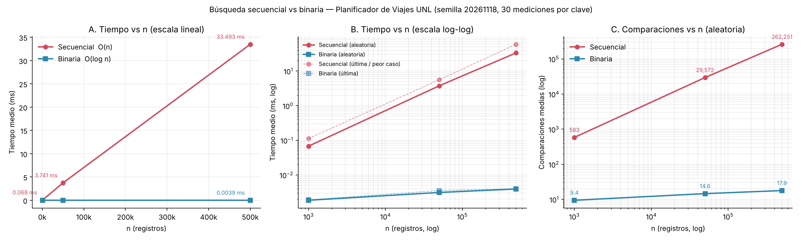

# Análisis de rendimiento: búsqueda secuencial vs binaria

Fuente: `scripts/resultados/busqueda/benchmark_busqueda.json` (Node v24.21.0, linux x64, semilla 20261118, 30 mediciones válidas por clave, 5 de calentamiento descartadas). Gráfico: `curvas_busqueda.png`.

## 1. Cuadro comparativo consolidado

Caso principal: **búsqueda exitosa en 20 posiciones aleatorias** (caso promedio). Se añaden el peor caso secuencial y la búsqueda fallida.

| n | Sec. tiempo (ms) | Bin. tiempo (ms) | Sec. comparaciones | Bin. comparaciones | Razón tiempo sec/bin | Sec. peor caso (ms) | Sec. fallida (ms) | Bin. fallida (ms) |
| --- | --- | --- | --- | --- | --- | --- | --- | --- |
| 1.000 | 0,0676 | 0,0018 | 582,9 | 9,4 | 37x | 0,1120 | 0,0778 | 0,0010 |
| 50.000 | 3,74 | 0,0031 | 29.572,4 | 14,6 | 1.204x | 5,61 | 4,03 | 0,0017 |
| 500.000 | 33,49 | 0,0039 | 262.251,4 | 17,9 | 8.567x | 59,30 | 40,20 | 0,0020 |

Costo de acceso al archivo (misma medición, una sola vez por carga):

| n | Tamaño (KB) | Lectura (ms) | Parseo JSON (ms) | Total (ms) |
| --- | --- | --- | --- | --- |
| 1.000 | 230,9 | 0,288 | 0,740 | 1,03 |
| 50.000 | 11.545,7 | 13,16 | 37,58 | 50,73 |
| 500.000 | 115.456,4 | 132,75 | 445,32 | 578,06 |

## 2. Gráfico de curvas

- **A (lineal):** la secuencial sube en línea recta hasta 33,5 ms; la binaria queda pegada al eje.
- **B (log-log):** la secuencial tiene pendiente ≈ 1 (crece proporcional a n); la binaria es casi plana.
- **C (comparaciones):** 262.251 vs 17,9 en n = 500.000; es la medida determinista, independiente de la máquina.

## 3. Escalabilidad

| Salto de n | Crecimiento de n | Tiempo secuencial | Tiempo binario |
| --- | --- | --- | --- |
| 1.000 → 50.000 | 50x | ×55,4 | ×1,7 |
| 50.000 → 500.000 | 10x | ×9,0 | ×1,3 |

- **Secuencial, O(n):** el tiempo crece prácticamente en proporción a n (×55 con n×50; ×9 con n×10). Las comparaciones confirman la teoría: ≈ n/2 en el caso promedio y n en el peor caso y en la búsqueda fallida. Con 500.000 registros un promedio de 33,5 ms por consulta (59,3 ms en el peor caso).
- **Binaria, O(log n):** n crece 500 veces y las comparaciones solo pasan de 9,4 a 17,9 (≈ ⌊log₂ n⌋ + 1); el tiempo pasa de 0,0018 a 0,0039 ms. Se mantiene en microsegundos.
- **Ventaja:** 37x con 1.000 registros, 1.204x con 50.000 y 8.567x con 500.000; la brecha se ensancha con n.
- **Excepción:** si la clave es el primer elemento, la secuencial gana (1 comparación, 0,0001 ms frente a 0,0022 ms). Es un caso favorable puntual, no representativo.
- **Con los datos reales (11 rutas)** la diferencia es irrelevante; el análisis aplica si el catálogo crece (más cooperativas, horarios, paradas).

## 4. Sostenibilidad

Importante: **este benchmark midió comparaciones y tiempo de CPU; no midió memoria ni energía.** Lo siguiente es lo que los datos sí sustentan y lo que es inferencia.

- **Cómputo por consulta (medido):** la binaria usa ~14.700 veces menos comparaciones que la secuencial con 500.000 registros. Menos CPU por consulta implica menos servidores/tiempo activo bajo carga; es una inferencia razonable, no una medición de energía.
- **Memoria (teórico):** ambas usan memoria auxiliar O(1); la diferencia no está en la memoria sino en el tiempo.
- **Costo de preparación de la binaria:** exige datos ordenados. Se ordena una vez (MergeSort del proyecto, O(n log n)) y se amortiza entre muchas consultas; si los datos cambian con frecuencia, hay que mantener el orden al insertar.
- **Costo dominante en archivos JSON (medido):** con 500.000 registros leer y parsear el archivo cuesta ≈ 578 ms, unas 17 veces más que una búsqueda secuencial (33,5 ms) y ~150.000 veces más que una binaria. Por sostenibilidad, el arreglo debe **cargarse una vez en memoria** (o usar caché, issue #7) y no releerse por consulta; para volúmenes grandes convendría una base de datos o un índice real.
- **Limitaciones:** una sola máquina y versión de Node; los tiempos absolutos varían entre equipos, la razón y las comparaciones son la base más estable. Los datos son las 11 rutas reales repetidas con id único, no 500.000 rutas distintas.

## 5. Decisión técnica

Usar **búsqueda binaria** sobre el arreglo ordenado (criterio cooperativa → nombre → id) cuando el catálogo crezca; mantener la secuencial solo para colecciones pequeñas o sin ordenar. Cargar el archivo una sola vez y cachear.

## Correcciones respecto al análisis anterior

El `analisis_rendimiento.md` previo citaba valores que no coinciden con `benchmark_busqueda.json`: «superando los 73 ms» (dato real: 33,49 ms promedio; 59,30 ms en el peor caso) y «alrededor de 0,008 ms» para la binaria (dato real: 0,0039 ms). Esta versión usa los valores del JSON. Además, el gráfico previo (`benchmark_graficos.html`) usa `fetch` del JSON, que no funciona abriendo el HTML con doble clic (`file://`); el PNG adjunto no tiene esa limitación.
